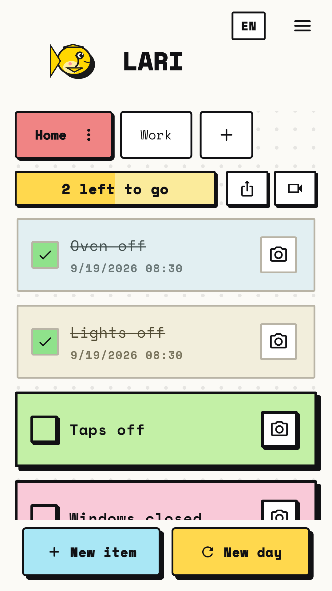
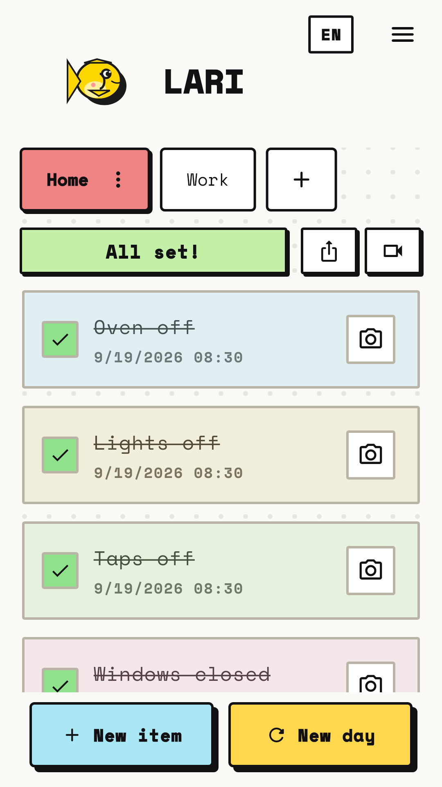
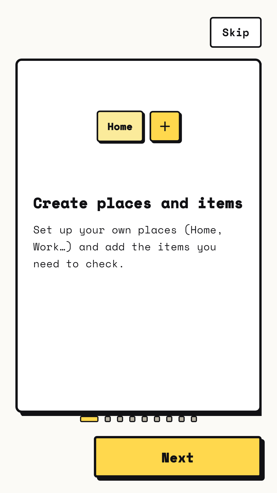
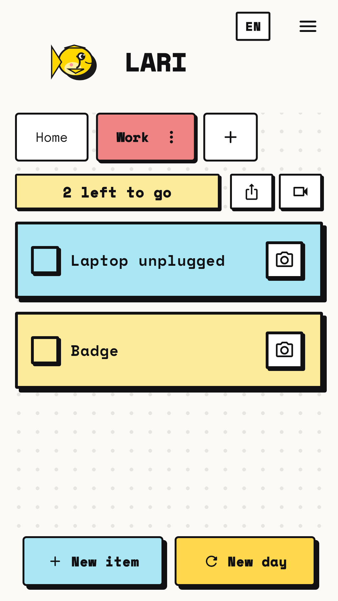

# Lari — Leaving Checklist

An Android app for the list you tick before you leave home: *did I turn off the
oven, did I lock the door?* Built with Flutter, published on Google Play.

**Google Play:** https://play.google.com/store/apps/details?id=com.anita.lari
**Privacy policy:** https://balnatalp.github.io/lari-privacy-policy/

> The full source code is private. This repository shows the decisions behind the
> app and a few selected excerpts. Full code access is available on request.

   

## What it does

- A separate checklist for each place: home, work, holiday home
- "New day" clears every tick in one tap
- A photo attached to an item, as proof for yourself (a short silent video comes
  in version 1.2.0, currently in Play review)
- Dictation instead of typing
- Share the list as an image; export and import to move to a new phone
- Four languages: English, Hungarian, Spanish, Chinese; light and dark theme;
  adjustable text size

## Tech stack

Flutter / Dart · Provider · shared_preferences · camera, video_player,
speech_to_text, share_plus, file_picker · GitHub Actions (analyze + test) ·
Python scripts for store assets · Google Play Console

## Decisions and trade-offs

**No internet permission at all.**
The app's promise is that nothing leaves the phone, so it simply cannot go online:
the Android manifest has no `INTERNET` permission, which I check again on the
release bundle. The Play Data Safety answer is "no data collected, none shared".
The one honest exception, written in the store text and the privacy policy:
dictation uses the phone's own speech recogniser, which may process audio on its
provider's servers.

**Only the permissions the app needs.**
Some plugins bring in storage permissions (`READ/WRITE_EXTERNAL_STORAGE`). Photos
and videos live in the app's private folder, so the manifest removes those
permissions explicitly with `tools:node="remove"`.

**A local error log instead of Crashlytics or Sentry.**
A crash reporter would have made the privacy statement false. Unhandled errors are
written to a size-limited log in the app's private folder; the user can view,
share or delete it from the menu.
→ [`error_log.dart`](excerpts/lib/services/error_log.dart)

**Serialised writes.**
Every change follows a "read everything, modify, write everything back" pattern.
Two changes at once (ticking an item while a reorder is still saving) could drop
the first one, so all writes go through a single queue.
→ [`database_service.dart`](excerpts/lib/services/database_service.dart)

**A gesture instead of a button for deleting.**
Testers in the closed test could not find how to delete an item. I first added a
⋮ menu to each item; it cost 48 px of the item name and pushed longer labels onto
two lines, so I reverted it. Now the guide shows the swipe-left gesture, and on
first launch the first card nudges left twice.

**Text size on top of Android's setting.**
A tester found the list too small even with the system default. The in-app setting
is a multiplier on Android's text scale, not a replacement, so someone who has
already enlarged text on the phone does not lose it.

**Video only when the documentation was ready.**
Video recording was finished in the code, but the store listing and privacy policy
did not mention it. I treated that as the release blocker: version 1.2.0 was
submitted to Google Play only after the guide, the store texts in all four languages
and the privacy policy described it (silent, one minute at most, deleted by "New
day"). As of November 2026 it is in Play review; the live version is 1.0.1.

**Store texts from a single source.**
The store texts existed twice and could drift apart. Now `fastlane/metadata` is the
only source; a script checks Play's character limits on it and generates the
human-readable copy.
→ [`check_store_listing.py`](excerpts/scripts/check_store_listing.py)

## What didn't work

- **A crash on launch that the build did not show.** A wrong `namespace` built
  fine and crashed only after installing on a real device. Since then the release
  steps start with installing on a phone and walking through the app once.
- **Tests that hung instead of failing.** `RepaintBoundary.toImage()` never
  completes in the test's fake-time zone unless wrapped in `tester.runAsync`, and
  `pumpAndSettle()` times out on screens with endless animations. Both are
  documented for anyone writing the next test.
- **A regression test that passed on the broken code.** In an error-log test, the
  ASCII text of `StackTrace.current` diluted the input, so the faulty calculation
  still came out positive: the test was green and the bug was there. Since then,
  for every regression test I put the bug back and check that the test fails.
- **Backups overwriting each other.** Every export was called `lari-backup.json`,
  so a new one replaced the old one in Downloads. Testers reported it; file names
  now carry the date and time.
  → [`backup_service.dart`](excerpts/lib/services/backup_service.dart)

## How I worked

- **CI on every push:** `flutter analyze` and `flutter test` (60 tests) in GitHub
  Actions.
  → [`ci.yml`](excerpts/.github/workflows/ci.yml)
- **Layout smoke tests:** every screen is built on the narrowest phone width and
  with 2× text, so overflow errors are caught before a phone shows them.
  → [`screens_smoke_test.dart`](excerpts/test/screens_smoke_test.dart)
- **Accessibility tests:** text and button contrast in light and dark theme,
  minimum tap target size, a screen-reader label on everything tappable.
  → [`accessibility_test.dart`](excerpts/test/accessibility_test.dart)
- **Regression tests** for the bugs that were silent wrong behaviour rather than
  crashes (renaming a place, selection after import, trimming the error log in
  non-ASCII text, resolving photo paths).
  → [`regression_test.dart`](excerpts/test/regression_test.dart)
- **Store screenshots rendered by widget tests** with realistic demo data, since
  the real renderer is used; the Chinese ones were taken on a real device.
- **Closed testing on Google Play** before release, and the feedback acted on in
  version 1.0.1.
- **Commit messages that explain why**, not only what changed.
- **AI assistant:** I used an AI coding assistant. I set the requirements, made
  the product and privacy decisions, reviewed the output and tested on real
  devices.

## Known limitations

- Published for Android only.
- Data lives on one device; moving to a new phone is a manual export and import.
